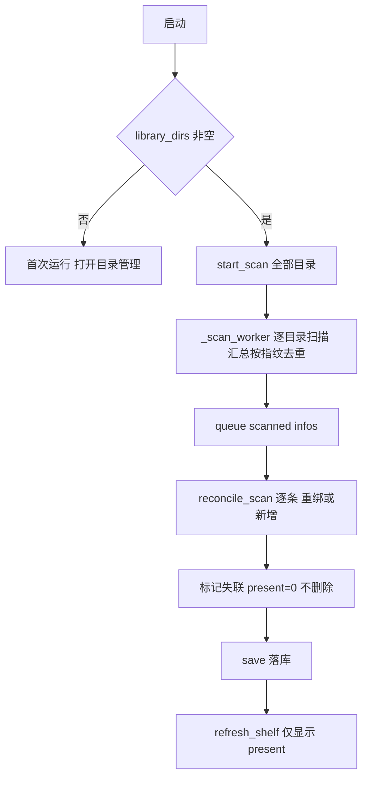

# 多书籍目录 + 记忆零丢失 实现规格（PyShelf）

> 目标：把「选择单一书籍目录」扩展为「管理多个书籍目录」，采用**统一书架汇总**，且**书签/高亮/阅读进度/阅读会话不丢失**（书籍移动、换目录、目录被移除后可自动重绑恢复）。
> 本文档为「照抄即可编码」的规格，不含代码改动；所有定位均给出 `文件:行号`。

---

## 0. 设计总览



核心不变式（必须成立）：

1. **记忆只随 book.id 存在**：bookmarks / highlights / reading_sessions 全部外键指向 `books.id`（`core/storage.py:38-63`）。因此「保记忆」=「保 id 或把旧 id 的记忆迁到新 id」。
2. **扫描永不删除记忆**：目录移除、文件消失时只把记录标记 `present=0`（隐藏），不 `DELETE`。
3. **id 不稳定时用内容指纹重绑**：`fingerprint = mtime_ns:size` 在「移动文件」场景保持不变，可作为跨路径身份键。

---

## 1. 数据模型 / 存储层设计

### 1.1 多目录持久化（复用 meta 表）

决策：**沿用 SQLite `meta` 表**（而非 `data/settings.json`），理由：书籍记忆与目录配置同库，迁移/备份只需 `data/library.db` 一个文件；且已有 `library_dir` 键先例（`core/storage.py:112-113`）。

- 新增 meta 键 `library_dirs`，值为 **JSON 数组字符串**，如 `["F:\\Books","D:\\PDF"]`。
- **保留** `library_dir` 键作向后兼容：`set_library_dirs` 时同时把**首个目录**写回 `library_dir`；`get_library_dirs` 在 `library_dirs` 为空时回退读取 `library_dir`。

新增/修改函数（`core/storage.py`，紧跟 `set_library_dir` 之后，约 `core/storage.py:112-113`）：

```python
import os
def _norm_dir(p: str) -> str:                 # 建议放 core/models.py 或此处
    return os.path.normcase(os.path.normpath(os.path.abspath(p))) if p else ""

def get_library_dirs(self) -> list[str]:
    """返回规范化后的目录列表（去重、保序）。
    优先读 library_dirs(JSON)；缺失/空则回退 [library_dir]；再空返回 []。"""
    raw = self.get_meta("library_dirs", "")
    dirs: list[str] = []
    if raw:
        try:
            v = json.loads(raw)
            if isinstance(v, list):
                dirs = [str(x) for x in v if isinstance(x, (str, bytes)) and str(x).strip()]
        except json.JSONDecodeError:
            dirs = []
    if not dirs:
        legacy = self.get_meta("library_dir", "")
        if legacy:
            dirs = [legacy]
    # 规范化 + 去重（保序，Windows 大小写不敏感用 normcase）
    out, seen = [], set()
    for d in dirs:
        nd = _norm_dir(d)
        if nd and nd not in seen:
            seen.add(nd)
            out.append(nd)
    return out

def set_library_dirs(self, dirs: list[str]) -> None:
    """持久化目录列表；顺带把首项写回 library_dir 兼容旧代码。"""
    out, seen = [], set()
    for d in dirs:
        nd = _norm_dir(d)
        if nd and nd not in seen:
            seen.add(nd); out.append(nd)
    self._set_meta("library_dirs", json.dumps(out, ensure_ascii=False))
    self._set_meta("library_dir", out[0] if out else "")
```

> 存储原始（非 normcase）路径用于展示更友好时，可另存展示值，但**匹配/去重一律用 `_norm_dir`**。

### 1.2 SCHEMA_VERSION 升级到 2

决策：**升级到 2**（新增 `books.present` 列 + 新增 meta 键）。迁移为**纯新增**，无删除，零丢失。

`core/storage.py:18` 改为 `SCHEMA_VERSION = 2`。

`_SCHEMA`（`core/storage.py:25-37`）books 表新增一列（新建库用）：

```sql
CREATE TABLE IF NOT EXISTS books (
    ...,
    fingerprint  TEXT    NOT NULL DEFAULT '',
    present      INTEGER NOT NULL DEFAULT 1
);
CREATE INDEX IF NOT EXISTS idx_books_fingerprint ON books(fingerprint);
```

`Storage.__init__`（`core/storage.py:92-99`）迁移扩展（既有 `fingerprint` 补列范式，`core/storage.py:93-98`）：

```python
cols = {r[1] for r in self.conn.execute("PRAGMA table_info(books)")}
if "fingerprint" not in cols:
    self.conn.execute("ALTER TABLE books ADD COLUMN fingerprint TEXT NOT NULL DEFAULT ''")
if "present" not in cols:
    self.conn.execute("ALTER TABLE books ADD COLUMN present INTEGER NOT NULL DEFAULT 1")
self.conn.execute("CREATE INDEX IF NOT EXISTS idx_books_fingerprint ON books(fingerprint)")
self.conn.commit()
self._migrate_dirs()                      # v1 -> v2 目录迁移
self._set_meta("schema_version", str(SCHEMA_VERSION))
```

新增迁移函数：

```python
def _migrate_dirs(self):
    """v1 -> v2：把旧的单值 library_dir 升为 library_dirs 数组。幂等。"""
    if self.get_meta("library_dirs", ""):
        return
    legacy = self.get_meta("library_dir", "")
    if legacy:
        self.set_library_dirs([legacy])
```

> `schema_version` 仅作记录，不参与强校验；判据始终是「列/键是否存在」。

### 1.3 记忆重绑所需的数据支撑

决策：**复用 `fingerprint`（mtime_ns:size），不新增 `content_hash` 列**；新增 `books.present` 列用于「失联但保记忆」；新增 fingerprint 索引加速候选查询（真实场景下候选搜索在内存 `Library.books` 完成，索引为可选优化）。

`core/models.py` `Book`（`core/models.py:26-40`）新增字段：

```python
    present: bool = True      # 本次扫描是否在磁盘命中；False = 失联(隐藏但保留记忆)
```

`fingerprint` 语义从「增量跳探测」扩展为「内容身份键」（`core/models.py:40` 注释同步更新）。

---

## 2. 记忆重绑定算法（核心）

### 2.1 内容身份键（分级匹配）

| 级别 | 键 | 适用场景 | 误判风险 |
|---|---|---|---|
| L1 | `fingerprint`（mtime_ns:size）完全相等 | 文件**移动/改路径**（mtime、size 不变） | 极低 |
| L2 | `size 相等 且 clean_title 相等` | 文件被**复制/触碰**（mtime 变、size 与标题不变） | 低 |
| — | 无匹配 | 全新书 | — |

不做内容 hash：需额外列与全量读盘，收益低于成本（文件名清洗已能辅助 L2）。若未来需要，加列 `content_hash TEXT` 走同样补列迁移即可。

### 2.2 触发时机

仅在扫描发现「**新路径 → 新 id 不在库中**」时尝试重绑。等价条件：`book_id_for(new_path) not in self.books`（`core/models.py:9-10`）。

### 2.3 重绑流程（伪代码 + 规则）

```
输入: infos = [(path_s, title, ext, pages, readable, fp), ...]   # 本次扫描结果
scanned = { i.path_s }                                            # 命中路径集合
claimed = set()                                                   # 已被本次扫描占用的旧 id

for info in infos:
    bid = book_id_for(path_s)
    if bid in self.books:          # 现役：常规刷新元数据
        b = self.books[bid]; 更新 title/ext/pages/readable/fingerprint; b.present=True
        continue

    old_id = _find_rebind(fp, title, scanned, claimed)   # 找失联候选
    if old_id:
        old = self.books.pop(old_id)      # 记忆整体搬到新 id
        old.id = bid; old.path = path_s; old.title=title; old.ext=ext
        if pages: old.pages = pages
        old.readable = readable; old.fingerprint = fp; old.present = True
        self.books[bid] = old
        claimed.add(old_id)
        self._pending_delete.append(old_id)   # save() 时删旧行
    else:
        self.books[bid] = Book(id=bid, path=path_s, title=title, ext=ext,
                               pages=pages, readable=readable, fingerprint=fp, present=True)

# 失联标记（绝不删除）
for b in self.books.values():
    if b.path not in scanned:
        b.present = False
```

```python
def _find_rebind(self, fp: str, title: str, scanned: set, claimed: set) -> str | None:
    """返回应被重绑的旧 book_id；无匹配返回 None。确定性、无副作用。"""
    def orphan(b):  # 仅失联且未被占用
        return b.id not in claimed and b.path not in scanned

    # L1: 指纹完全相等
    cands = [b for b in self.books.values() if orphan(b) and fp and b.fingerprint == fp]

    # L2: size + 标题相等（尺寸取 fingerprint 的 size 段）
    if not cands and fp and ":" in fp:
        size = fp.split(":")[-1]
        cands = [b for b in self.books.values()
                 if orphan(b) and b.title == title and b.fingerprint
                 and b.fingerprint.split(":")[-1] == size]

    if not cands:
        return None
    # 歧义消解：最近打开优先 → 路径稳定排序（保证确定性）
    cands.sort(key=lambda b: (-b.last_opened, b.path))
    return cands[0].id
```

### 2.4 冲突与歧义处理规则（明确）

- **同指纹多本（真假同文件）**：按「`last_opened` 大者优先 → `path` 字典序小者」选**唯一**一本迁移；其余候选**保持失联、记忆保留**，等下轮或文件回归。
- **一次扫描两个新路径指向同一旧记录**：由 `claimed` 保证**只被占用一次**，先到先得（`infos` 已按去重后顺序）。
- **重绑目标 id 已存在**：不存在冲突——`bid not in self.books` 是前置条件；旧记录 pop 后再写入，不会覆盖他人。
- **旧 id 与库中其它记录的子表主键冲突**：不会发生。bookmarks 主键为 `(book_id,page)`（`core/storage.py:42`），迁移后 book_id 变化即天然隔离。
- **多个新书都匹配不到**：各自建新记录，互不影响。

### 2.5 新增/修改函数签名（本算法相关）

| 文件 | 函数 | 变更 |
|---|---|---|
| `core/library.py` | `reconcile_scan(self, infos: list[tuple]) -> dict` | **新增**，实现 2.3 |
| `core/library.py` | `_find_rebind(self, fp, title, scanned, claimed) -> str \| None` | **新增** |
| `core/library.py` | `save(self)`（`core/library.py:48-49`） | 增加：`for oid in self._pending_delete: self.store.delete_book(oid)`，然后清空 |
| `core/library.py` | `__init__`（`core/library.py:22-34`） | 新增 `self._pending_delete: list[str] = []` |
| `core/storage.py` | `delete_book(self, book_id)`（`core/storage.py:166-169`） | 不变（用于清理旧行，CASCADE 清记忆残留） |

> 落库走既有 `save_book`（`core/storage.py:133-160`，全量 DELETE/INSERT 子表）——重绑后的 Book 已带旧记忆，保存即在**新 id** 下写回，等价于「记忆迁移」，无需新增 SQL。

---

## 3. 库层设计（core/library.py）

- `Library.library_dirs: list[str]`：**新增**（`core/library.py:31` 附近）。
- `Library.library_dir: str`：**保留为兼容单值**，取值 `library_dirs[0]`（无则 `""`）。

`_load`（`core/library.py:37-42`）改为：

```python
self.library_dirs = self.store.get_library_dirs()
self.library_dir = self.library_dirs[0] if self.library_dirs else ""
self.books = self.store.load_all()
self._pending_delete = []
```

新增目录管理 API：

```python
def add_dir(self, path: str) -> bool:
    """规范化加入；已存在返回 False。持久化但不触发扫描（由 app 负责）。"""
    nd = _norm_dir(path)
    if not nd:
        return False
    if nd in self.library_dirs:
        return False
    self.library_dirs.append(nd)
    self.library_dir = self.library_dirs[0]
    self.store.set_library_dirs(self.library_dirs)
    return True

def remove_dir(self, path: str) -> bool:
    """仅从配置移除，不删除任何书籍记录与记忆。"""
    nd = _norm_dir(path)
    if nd not in self.library_dirs:
        return False
    self.library_dirs.remove(nd)
    self.library_dir = self.library_dirs[0] if self.library_dirs else ""
    self.store.set_library_dirs(self.library_dirs)
    return True

def count_books_under(self, path: str) -> int:
    """该目录下当前在架(present)书籍数，供 UI 展示。"""
    pre = _norm_dir(path) + os.sep
    return sum(1 for b in self.books.values()
               if b.present and _norm_dir(b.path).startswith(pre))
```

`upsert`（`core/library.py:59-71`）扩展：新增 `fingerprint` 参数，写入 `book.fingerprint`、`book.present = True`；保持向后调用兼容（默认 `fingerprint=""`）。

```python
def upsert(self, path, title, ext, pages, readable, fingerprint="") -> Book:
    ...
    book.fingerprint = fingerprint
    book.present = True
    return book
```

`search_titles`（`core/library.py:99-102`）：返回前过滤 `present`（`[self.books[i] for i in ids if i in self.books and self.books[i].present]`）。

**多目录扫描聚合与去重**：见 §4；去重键用 **fingerprint**（内容），不是 path。

---

## 4. 扫描与后台流程

### 4.1 `start_scan`（app.py:250-259）改为接收目录列表

```python
def start_scan(self, dirs: list[str]):
    self.library.library_dirs = list(dirs)
    self.library.library_dir = dirs[0] if dirs else ""      # 兼容取首个
    self.library.store.set_library_dirs(self.library.library_dirs)
    self.library.save()                                     # 落库(含失联标记)
    self.status_lbl.configure(text="扫描中…")
    # 快照: path -> (指纹, 页数)，仅对在架书构建
    snapshot = {b.path: (b.fingerprint, b.pages)
                for b in self.library.books.values()
                if b.readable and b.pages > 0 and b.fingerprint}
    threading.Thread(target=self._scan_worker, args=(list(dirs), snapshot),
                     daemon=True).start()
```

> 为兼容 `dl_done` 等旧调用（`app.py:329`）与新约定，**统一传 list**；调用点全部改 `self.start_scan(self.library.library_dirs)`。

### 4.2 `_scan_worker`（app.py:261-291）多目录汇总 + 内容去重

```python
def _scan_worker(self, dirs: list[str], snapshot: dict):
    infos, seen = [], set()          # seen 存去重键
    for d in dirs:
        for p in scanner.scan_files(d):          # core/scanner.py:50-63
            pages, readable, fp = 0, True, ""
            try:
                st = p.stat(); fp = f"{st.st_mtime_ns}:{st.st_size}"
            except OSError:
                continue                          # 不可读：跳过，不建失联
            key = fp or str(p)                    # 内容优先，无指纹退回路径
            if key in seen:
                continue                          # 同一书在重叠/多目录 → 只留首次
            seen.add(key)
            cached = snapshot.get(str(p))
            if cached and cached[0] == fp:
                pages = cached[1]
            elif p.suffix.lower() == ".pdf":
                pages, readable = scanner.probe_pdf(p)     # core/scanner.py:66-74
            infos.append((str(p), scanner.clean_title(p.name),
                          p.suffix.lower(), pages, readable, fp))
    self.q.put(("scanned", infos))

    # 封面：仅对在架(present)且缺封面的书渲染（避免给失联文件做无用功）
    todo = [b for b in list(self.library.books.values())
            if b.present and not (b.cover_ok
                                  and scanner.cover_path(DATA_DIR, b.id).exists())]
    for b in todo:
        ok = scanner.generate_cover(Path(b.path), scanner.cover_path(DATA_DIR, b.id),
                                    b.title, b.ext)
        b.cover_ok = ok
        self.q.put(("cover", b.id))
    self.q.put(("done", len(todo)))
```

> `snapshot` 键由单目录的 `lib_dir` 变为多目录 —— 结构不变，仍按绝对 `path` 命中。

### 4.3 `_handle_msg` 的 `"scanned"` 分支（app.py:296-315）

**替换**现有「按 path 去重 + 删除不在册记录」逻辑（`app.py:299-306`）为一次 `reconcile_scan`：

```python
if kind == "scanned":
    infos = msg[1]
    stats = self.library.reconcile_scan(infos)   # 内部：重绑 / 新增 / 标记失联
    self.library.save()                          # 落库 + 清理重绑遗留旧行
    self.refresh_shelf()
    self.status_lbl.configure(
        text=f"书库 {stats['present']} 本 · 失联 {stats['missing']} 本 · 封面生成中…")
```

`reconcile_scan` 返回示例：`{"present": n, "missing": m, "added": a, "rebound": r}`。

`"done"` 分支（app.py:312-315）保持 `save + refresh`，状态文案改用 `_status_text()`（§3 已过滤失联计数）。

其它消息分支（`cover`/`src_*`/`dl_*`）不变；仅 `dl_done`（`app.py:329`）的 `self.start_scan(self.library.library_dir)` → `self.start_scan(self.library.library_dirs)`。

### 4.4 进度 / 封面逻辑保持不变

- 进度读：`ui/reader_view.py:119`；写：`ui/reader_view.py:235` → `app.py:457-459` → `core/library.py:73-75 touch_history`。**均基于 Book 对象，重绑后对象依旧，天然保进度。**
- 封面路径按 `id` 推导（`core/scanner.py:77-78`）。重绑换 id 后按下轮 `_scan_worker` 重建封面即可（旧封面 PNG 成孤儿，见 §6 清理项）。

---

## 5. UI 交互设计

### 5.1 顶栏按钮（app.py:191-192）

文案「选择书库目录」→ **「管理书籍目录」**，命令 `self._manage_dirs`：

```python
self._mk_btn(bar, "管理书籍目录", self._manage_dirs, dim=True).pack(
    side="right", padx=(10, 3))
```

### 5.2 目录管理对话框（新增 `ui/dir_manager.py`）

轻量 `tk.Toplevel`，风格复用 `app._mk_btn`（`app.py:148-159`）与 `T` 配色（`ui/theme.py`）：

```python
class DirManagerDialog(tk.Toplevel):
    def __init__(self, master, app):        # app 为 PyShelfApp
        ...
        self.app = app
        self.lb = tk.Listbox(...)          # 每行: "<目录>  ·  N 本"
        self._refresh()

    def _refresh(self):
        self.lb.delete(0, "end")
        for d in self.app.library.library_dirs:
            n = self.app.library.count_books_under(d)
            self.lb.insert("end", f"{d}   ·   {n} 本")

    def _add(self):
        d = filedialog.askdirectory(title="添加书籍目录", parent=self,
                                    initialdir=str(Path.home()))
        if not d:
            return
        if not Path(d).is_dir():
            messagebox.showerror("无效目录", "目录不存在或不可访问。", parent=self); return
        if self.app.library.add_dir(d):
            self._refresh()
            self.app.start_scan(self.app.library.library_dirs)   # 触发重扫
        else:
            messagebox.showinfo("已存在", "该目录已在列表中。", parent=self)

    def _remove(self):
        sel = self.lb.curselection()
        if not sel:
            return
        d = self.app.library.library_dirs[sel[0]]
        if messagebox.askyesno("移除目录",
                f"从书架移除目录：\n{d}\n\n"
                "书籍与阅读记录（书签/高亮/进度）将保留，"
                "重新添加该目录即可恢复。", parent=self):
            self.app.library.remove_dir(d)     # 只改配置，不删记忆
            self._refresh()
            self.app.start_scan(self.app.library.library_dirs)
```

对话框按钮：`添加目录` / `移除所选` / `关闭`；双击行 = 打开该目录（可选，`os.startfile`）。

### 5.3 入口与启动流程调整

- 旧 `_pick_dir`（app.py:243-248）：语义改为「添加目录」。可保留薄封装：`askdirectory → library.add_dir → start_scan(library_dirs)`；或直接删除、全部走 `_manage_dirs`。**建议保留 `_pick_dir` 作为首次运行的快速入口**。
- 首次运行 `_first_run`（app.py:234-241）：文案改为「请选择书籍目录（可添加多个，递归扫描 PDF/EPUB/TXT/MD）」，并打开 `_manage_dirs`（或沿用 `_pick_dir`）。
- 启动判断（app.py:126-129）：

```python
if self.library.library_dirs:
    self.start_scan(self.library.library_dirs)
else:
    self.after(200, self._first_run)
```

- `_visible_books`（app.py:366-378）：首行加 `books = [b for b in self.library.books.values() if b.present]`，失联书不显示（但记忆保留）。
- `_status_text`（app.py:353-363）：`n = sum(1 for b in self.library.books.values() if b.present)`。
- `start_downloads`（app.py:489-493）：目标目录保持 `library_dir`（首个）；无目录时退回 `DATA_DIR`（现状即如此）。

---

## 6. 边界与异常

| # | 场景 | 规则 / 处理 |
|---|---|---|
| 1 | 目录不存在 / 不可访问 | `add_dir` 前 `Path(d).is_dir()` 校验；`scanner.scan_files` 已对非目录返回 `[]`（`core/scanner.py:52-53`）；扫描期 `stat` 失败跳过该文件（不建失联） |
| 2 | 重复添加同一目录 | `_norm_dir`（normcase+normpath）后去重，`add_dir` 返回 `False`，UI 提示「已存在」 |
| 3 | 父子目录嵌套（同一书被扫两次） | 两目录都列出时：路径相同 → worker `seen` 按 `fp or path` 去重，只留首次；不会产生重复记录 |
| 4 | 不同路径同一内容（复制件） | 指纹相同 → worker 去重，保留首次出现；第二份不进库，不影响记忆 |
| 5 | 符号链接 / 递归 | `scan_files` 用 `rglob`（`core/scanner.py:55`），符号链接目录可能被跟随造成重复；用 `seen` 去重兜底。如出现环，建议后续对 `Path.is_symlink()` 的目录跳过（可选加固） |
| 6 | Windows 路径大小写 | `_norm_dir` 用 `os.path.normcase`；匹配/去重/`count_books_under` 一律规范化后比较 |
| 7 | 书被删除但记忆保留 | 扫描未命中 → `present=0`，记录与记忆保留；重新出现（或按指纹重绑）后恢复 |
| 8 | 移除目录 | 仅 `remove_dir` 改配置；重扫后该目录书籍 `present=0` 隐藏保留；重加目录即恢复 |
| 9 | 重绑后 `unique(path)` 冲突 | 新 id 对应新 path，且写入前 `bid not in self.books`，不会撞已有 path；旧行经 `delete_book` 删除释放其 path |
| 10 | 重绑后 FTS 冲突 | `save_book` 先 `DELETE FROM books_fts WHERE book_id=?` 再插入（`core/storage.py:158-160`），新 id 无残留；旧 id 的 FTS 由 `delete_book` 清除（`core/storage.py:168`） |
| 11 | 封面孤儿 PNG | 重绑换 id 后旧封面 PNG（以旧 id 命名）成孤儿；可选：`done` 分支后清理 `data/covers/*.png` 中 id 不在 `books` 的文件（非必须，不影响正确性） |
| 12 | 同一书在两个目录、其一被移除 | 首次命中的记录 present=1；被移除目录不改变现状（另一目录仍能命中同一 path 或同内容） |

---

## 7. 测试计划

### 7.1 单元测试

**`tests/test_storage.py` 扩展：**

- `test_library_dirs_roundtrip`：`set_library_dirs(["a","b"])` 后 `get_library_dirs()==[normcase..]`，且 `get_meta("library_dir")==首个`。
- `test_library_dirs_legacy_fallback`：仅写 `library_dir` 旧键、`Storage` 重新打开 → `get_library_dirs()` 回退为单元素；`_migrate_dirs` 后 `library_dirs` 键已写入。
- `test_dirs_dedupe_normcase`：`["C:\\A","c:\\a\\"]` → 只留一条。
- `test_present_column_upgrade`：仿 `test_old_db_upgrade_adds_fingerprint`（`tests/test_storage.py:119-137`），旧库无 `present` 列 → 自动补列，默认 1。
- `test_present_roundtrip`：`save_book` 写 present=0 后 `load_all` 读回 False。

**新增 `tests/test_multi_dirs.py`（推荐）：**

- `test_reconcile_adds_and_marks_missing`：扫描 A 目录建 N 本；再扫描 B 目录 → A 的记录 `present=False`（未删）、B 新增。
- `test_rebind_on_move_keeps_memory`：建书 → 加书签/高亮/进度 → `save` → 把文件 `rename` 到新路径（保 mtime/size）→ `reconcile_scan([新路径 infos])` → 断言：旧 id 消失、新 id 存在、`bookmarks/highlights/progress` 完整迁到新 id（核心防丢）。
- `test_rebind_ambiguous_picks_last_opened`：两条同指纹失联记录 → 重绑选 `last_opened` 大者；另一条仍失联。
- `test_rebind_degraded_size_title`：改 mtime 后（指纹变）仍能按 size+title 重绑。
- `test_remove_dir_keeps_memory`：`add_dir` 两目录并扫描 → `remove_dir` 一个 → 重扫 → 该目录书 `present=False` 且书签/高亮仍在库。
- `test_scan_dedupe_by_fingerprint`：两目录含内容相同（同 mtime/size）文件 → 库中仅 1 条。

> 构造指纹：测试里对文件 `os.utime` 设置固定时间即可稳定得到 `mtime_ns`；或直接写 Book 的 `fingerprint` 字段断言逻辑。

### 7.2 手工验证步骤

1. 启动，首次运行 → 添加目录 A（含若干 PDF）。
2. `管理书籍目录` → 再添加目录 B（含另一批书）→ 书架出现 A+B 的并集，无重复。
3. 在 A 的某本书加书签、高亮、读到第 10 页 → 关闭。
4. `管理书籍目录` → 移除目录 A → 该批书仍在库（失联隐藏），记忆未删；重加 A → 书与记忆回归。
5. 在资源管理器把某 PDF 移到另一个子目录（同盘移动）→ 重扫 → 该书仍在架，书签/高亮/进度完好。
6. 删除某 PDF 文件 → 重扫 → 该书从书架消失但无报错；恢复文件后重扫 → 回归。
7. 添加 A 的**父目录**（嵌套）→ 不产生重复书。

---

## 8. 实施顺序与影响文件清单

> 每步都可单独提交、可回滚（回滚 = 撤销该步文件改动；DB 迁移为纯新增，回滚旧代码仍可读，多余列/键被忽略）。

**Step 1 — 存储层多目录 + schema v2（低风险）**
- `core/storage.py:18` `SCHEMA_VERSION=2`
- `core/storage.py:20-67` `_SCHEMA` 加 `present` 列 + fingerprint 索引
- `core/storage.py:92-99` 补列/建索引/调用 `_migrate_dirs`
- `core/storage.py:112-113` 后新增 `get_library_dirs/set_library_dirs/_migrate_dirs`
- `core/storage.py:133-160` `save_book` upsert 增加 `present` 字段
- `core/models.py:26-40` `Book` 加 `present` 字段
- 风险：DDL 变更；回滚点：删列不可行但可忽略新列，旧代码不受影响。

**Step 2 — 库层：多目录属性 + 目录管理 + 重绑定（核心）**
- `core/library.py:22-34` 加 `library_dirs/_pending_delete`
- `core/library.py:37-42` `_load` 读多目录
- `core/library.py:48-49` `save` 清理 `_pending_delete`
- `core/library.py:59-71` `upsert` 加 `fingerprint` 参数
- `core/library.py:99-102` `search_titles` 过滤 present
- **新增** `add_dir/remove_dir/count_books_under/reconcile_scan/_find_rebind`
- 风险：重绑误并（用确定性排序 + 仅失联候选收敛风险）；回滚点：还原 `reconcile_scan` 为旧「按 path 去重+删除」。

**Step 3 — 扫描与后台（中等）**
- `app.py:250-259` `start_scan(list)`
- `app.py:261-291` `_scan_worker(dirs, snapshot)` 汇总去重 + 封面仅 present
- `app.py:296-315` `scanned` 分支改 `reconcile_scan`
- `app.py:329` `dl_done` 传 `library_dirs`
- 风险：后台线程与主线程竞态（沿用现有「IO 在后台、字典改主线程」范式）；回滚点：还原单目录扫描。

**Step 4 — UI 多目录管理（低风险）**
- `app.py:191-192` 按钮改「管理书籍目录」→ `_manage_dirs`
- **新增** `app.py:_manage_dirs`（打开对话框）
- **新增** `ui/dir_manager.py`
- `app.py:234-248` 首次运行/`_pick_dir` 语义调整
- `app.py:126-129` 启动判断改 `library_dirs`
- `app.py:353-363` `_status_text` 计数 filtered present
- `app.py:366-378` `_visible_books` 过滤 present
- 风险：低；回滚点：还原按钮与 `_visible_books`。

**Step 5 — 测试与验收（低风险）**
- `tests/test_storage.py` 扩展（§7.1）
- **新增** `tests/test_multi_dirs.py`
- 手工验证（§7.2）

### 影响文件总表

| 文件 | 关键点 |
|---|---|
| `core/storage.py` | `SCHEMA_VERSION`、`_SCHEMA`、`__init__` 迁移、`get/set_library_dirs`、`_migrate_dirs`、`save_book(present)` |
| `core/models.py` | `Book.present` |
| `core/library.py` | `library_dirs`、`_pending_delete`、`add_dir/remove_dir/count_books_under/reconcile_scan/_find_rebind`、`upsert/save/_load/search_titles` |
| `app.py` | `start_scan`、`_scan_worker`、`_handle_msg`、`_visible_books`、`_status_text`、`_manage_dirs`、`_pick_dir`、首次运行、启动判断、`dl_done` |
| `ui/dir_manager.py` | **新增** 目录管理对话框 |
| `tests/test_storage.py` | 扩展存储测试 |
| `tests/test_multi_dirs.py` | **新增** 多目录/重绑/去重测试 |

---

## 附：关键不变式校验清单（编码后自检）

- [ ] 目录移除后 `SELECT count(*) FROM bookmarks` 不变（记忆零丢）。
- [ ] 移动文件后，新 id 下的 bookmarks/highlights/progress 与移动前一致。
- [ ] 任何情况下 `reconcile_scan` 不对 `books` 执行无条件 `DELETE`；仅 `delete_book(旧id)` 用于重绑遗留。
- [ ] `library_dirs` 为空且 `library_dir` 有值 → 仍能正确读回（向后兼容）。
- [ ] 重叠/嵌套目录不产生重复书（按 fingerprint 去重）。
- [ ] 失联书不计入书架视图与状态栏，但记录与记忆保留在库。
